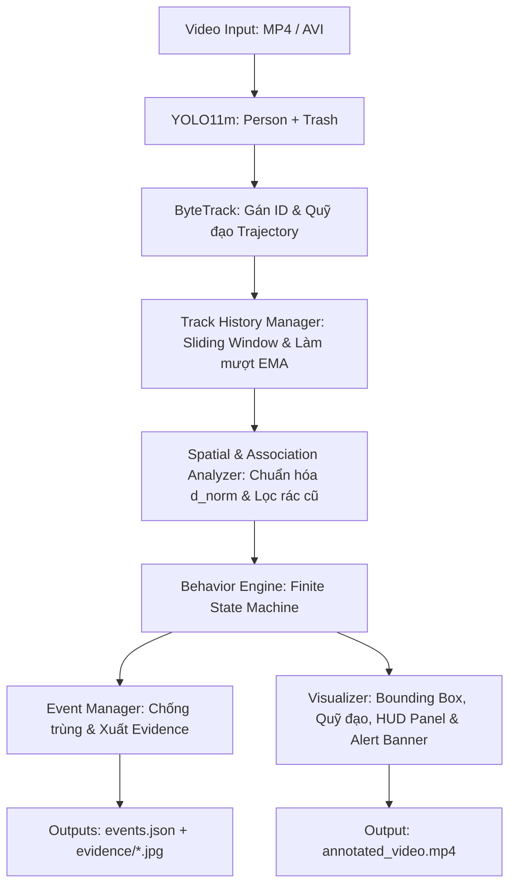
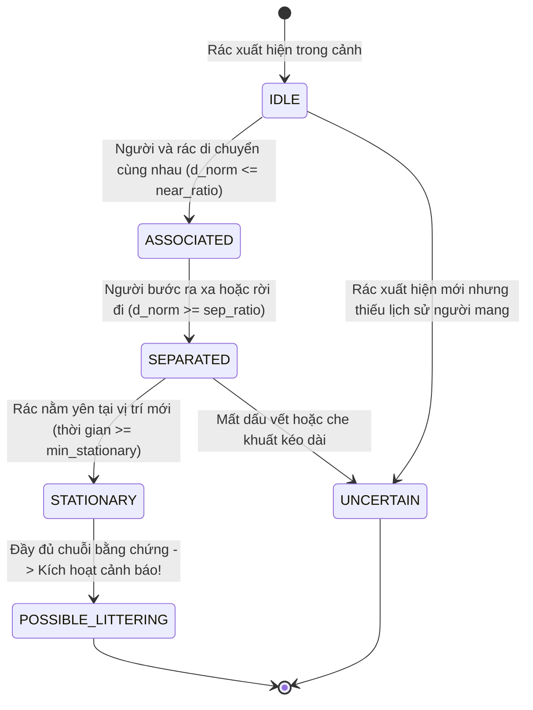

# AI Littering Behavior Detection System
### Hệ thống AI phát hiện hành vi xả rác trong video bằng Object Detection, ByteTrack và Suy luận Không gian – Thời gian (Spatio-Temporal Reasoning)

> **Đề tài dự thi Cuộc thi Khoa học Kỹ thuật (KHKT) dành cho học sinh Trung học Cơ sở (THCS)**  
> **Lĩnh vực:** Hệ thống nhúng & Phần mềm hệ thống / Trí tuệ nhân tạo (Computer Vision & Explainable AI)

---

## 1. Giới thiệu đề tài & Mục tiêu nghiên cứu

Hành vi xả rác bừa bãi tại nơi công cộng, sân trường, công viên gây ô nhiễm môi trường và làm mất mỹ quan đô thị. Các hệ thống camera giám sát truyền thống chỉ ghi lại hình ảnh mà không thể tự động phát hiện hay cảnh báo kịp thời khi có người xả rác.

Hệ thống **AI Littering Behavior Detection** được nghiên cứu và xây dựng nhằm giải quyết bài toán trên theo phương pháp tiếp cận **Trí tuệ nhân tạo có thể giải thích được (Explainable AI - XAI)**:
- **Không sử dụng các mô hình hộp đen (Black-box)** như Action Recognition 3D CNN hoặc Video-LLM nặng nề, khó triển khai trên phần cứng thực tế và không giải thích được lý do đưa ra kết luận.
- **Kết hợp Object Detection + ByteTrack + Finite State Machine (FSM)**: Nhận diện đối tượng người và rác, theo dõi quỹ đạo theo thời gian và kiểm tra chuỗi logic chuyển dịch vị trí thực tế:
  $$\text{Mang theo (Associated)} \longrightarrow \text{Tách rời (Separated)} \longrightarrow \text{Nằm yên (Stationary)} \longrightarrow \text{Xác nhận xả rác (Possible Littering)}$$

---

## 2. Điểm mới & Đóng góp kỹ thuật

1. **Chuẩn hóa khoảng cách theo tầm vóc người ($d_{norm}$):**
   $$d_{norm} = \frac{d(P, T)}{h_P}$$
   Khoảng cách Euclid giữa người ($P$) và rác ($T$) được chia cho chiều cao bounding box của người ($h_P$). Nhờ đó, thuật toán hoạt động chính xác ở cả cự ly gần và cự ly xa mà không phụ thuộc vào góc đặt camera.

2. **Bộ lọc rác có sẵn từ đầu cảnh (Pre-existing Trash Filter):**
   Rác đã nằm sẵn trên mặt đất trước khi người bước tới sẽ được hiệu chuẩn và gắn cờ `pre_existing = True`. Người đi ngang qua gần đống rác có sẵn tuyệt đối không bị cảnh báo nhầm thành người xả rác.

3. **Chống cảnh báo sai người gần nhất (Anti-Proximity Bias):**
   Hệ thống không mặc định người đứng gần rác là người xả rác, mà phải xác minh **lịch sử mang vật thể đi cùng** trước khi vật thể bị tách ra.

4. **Trích xuất bằng chứng tự động (Evidence Extraction):**
   Mỗi khi phát hiện sự kiện vi phạm, hệ thống tự động lưu file ảnh bằng chứng có đánh dấu bounding box người vi phạm, vị trí rác, mốc thời gian và xuất báo cáo JSON chi tiết.

---

## 3. Kiến trúc hệ thống & Sơ đồ luồng dữ liệu



### Sơ đồ máy trạng thái FSM (Behavior Finite State Machine)



---

## 4. Cấu trúc thư mục dự án

```text
KHKT_THCS/
├── main.py                     # Giao diện dòng lệnh CLI chính
├── config.yaml                 # Cấu hình tập trung tham số và ngưỡng phân ngưỡng
├── requirements.txt            # Danh sách thư viện phụ thuộc
├── README.md                   # Báo cáo và tài liệu hướng dẫn kỹ thuật
│
├── core/                       # Các module thuật toán cốt lõi
│   ├── detector.py             # Tải YOLO model, chuẩn hóa class mapping
│   ├── tracker.py              # Tích hợp ByteTrack, quản lý TrackedObject
│   ├── geometry.py             # Hàm toán học: d_norm, point_to_box, IoU, velocity, EMA
│   ├── history.py              # Lưu trữ sliding window và kiểm tra đứng yên (is_stationary)
│   ├── association.py          # Xác định liên kết Person–Trash & bộ lọc rác có sẵn
│   ├── behavior.py             # Máy trạng thái hữu hạn FSM nhận diện chuỗi hành vi
│   └── events.py               # Quản lý sự kiện, chống trùng lặp và lưu ảnh bằng chứng
│
├── pipeline/
│   └── video_processor.py      # Điều phối toàn bộ luồng xử lý khép kín của video
│
├── utils/
│   └── visualizer.py           # Vẽ Bounding Box, quỹ đạo, HUD status panel, banner cảnh báo
│
├── tools/
│   └── generate_sample_video.py # Công cụ tạo video giả lập kịch bản xả rác để kiểm thử
│
├── tests/                      # Bộ kiểm thử tự động toàn diện (Unit & Integration tests)
│   ├── test_geometry.py        # Kiểm thử tính toán hình học
│   ├── test_association.py     # Kiểm thử liên kết Người – Rác
│   ├── test_behavior.py        # Kiểm thử chuyển trạng thái FSM
│   ├── test_tracker_and_events.py # Kiểm thử dọn dẹp track và chống trùng lặp sự kiện
│   └── test_e2e_pipeline.py    # Kiểm thử tích hợp toàn bộ pipeline VideoProcessor
│
├── weights/                    # Thư mục lưu trữ trọng số mô hình AI (best.pt / yolo11.pt)
├── inputs/                     # Thư mục chứa video đầu vào để thử nghiệm
└── outputs/                    # Kết quả sau khi xử lý
    ├── videos/                 # Video có overlay Bounding Box, trạng thái và cảnh báo
    ├── evidence/               # Ảnh chụp bằng chứng thời điểm xảy ra sự kiện vi phạm
    └── events/                 # File JSON báo cáo chi tiết các sự kiện
```

---

## 5. Cài đặt môi trường

### Yêu cầu hệ thống
- **Hệ điều hành:** macOS (hỗ trợ Apple Silicon GPU `mps`), Linux (hỗ trợ NVIDIA GPU `cuda`), hoặc Windows.
- **Python:** Phiên bản 3.10 hoặc 3.11 khuyến nghị.

### Các bước cài đặt
```bash
# 1. Khởi tạo môi trường ảo Python
python3.11 -m venv venv

# 2. Kích hoạt môi trường ảo
source venv/bin/activate       # Trên macOS / Linux
# venv\Scripts\activate        # Trên Windows

# 3. Cài đặt các thư viện cần thiết
pip install -r requirements.txt
```

### Tải trọng số Pretrained Weights
Hệ thống tự động sử dụng model YOLO11m fine-tuned cho 2 class (`person`, `trash`) từ release:
```bash
# Tải trọng số tốt nhất về thư mục weights/
curl -L -o weights/best.pt "https://github.com/BaraaAlsaker/littering-detection/releases/download/v1.0.0/best.pt"
```

---

## 6. Hướng dẫn sử dụng

### 1. Chạy phát hiện trên video bất kỳ
```bash
source venv/bin/activate
python main.py -i inputs/ten_video_cua_ban.mp4
```

### 2. Tự động sinh video mẫu và chạy thử nghiệm (Demo mode)
```bash
python main.py --generate-sample
```

### 3. Tùy chỉnh tham số dòng lệnh
```bash
# Chỉ định file cấu hình riêng và đường dẫn xuất video
python main.py -i inputs/video.mp4 -c config.yaml -o outputs/videos/ket_qua.mp4

# Chế độ chạy nhanh không xuất video (chỉ lưu JSON và ảnh bằng chứng)
python main.py -i inputs/video.mp4 --no-video

# Chỉ định thiết bị phần cứng (mps: Apple Silicon GPU, cuda: Nvidia GPU, cpu: Vi xử lý)
python main.py -i inputs/video.mp4 --device mps
```

---

## 7. Kết quả đầu ra (Output Specifications)

### 1. File JSON sự kiện (`outputs/events/*.json`)
```json
{
  "total_events": 1,
  "events": [
    {
      "event_id": "EVT_0001",
      "event_type": "POSSIBLE_LITTERING",
      "timestamp": 3.42,
      "person_id": 1,
      "trash_id": 10,
      "evidence": ["associated", "separated", "stationary", "littering_confirmed"],
      "status_message": "Xác định hành vi nghi vấn xả rác: Người #1 bỏ lại vật thể #10",
      "evidence_image": "EVT_0001.jpg",
      "bbox_person": [280.0, 150.0, 320.0, 300.0],
      "bbox_trash": [205.0, 260.0, 225.0, 280.0]
    }
  ]
}
```

### 2. Ảnh bằng chứng (`outputs/evidence/EVT_0001.jpg`)
Ảnh frame tại thời điểm vi phạm với Bounding box người (màu cam), vật thể rác (màu đỏ) và thanh tiêu đề `EVIDENCE [POSSIBLE_LITTERING]` ghi rõ thời gian.

### 3. Video kết quả (`outputs/videos/*.mp4`)
Video mượt mà hiển thị:
- Hộp nhận diện và nhãn trạng thái FSM: `[ASSOCIATED]`, `[SEPARATED]`, `[STATIONARY]`, `[POSSIBLE_LITTERING]`.
- Đường liên kết nối giữa người và rác kèm chỉ số khoảng cách chuẩn hóa $d_{norm}$.
- Vệt quỹ đạo chuyển động (Trajectory trails) của từng đối tượng.
- Bảng hiển thị thông số HUD góc trên bên trái: thời gian, FPS thực tế, số lượng người và rác đang theo dõi.
- Banner cảnh báo màu đỏ ở cạnh dưới khung hình khi có hành vi vi phạm.

---

## 8. Kiểm thử tự động (Unit & Integration Tests)

Hệ thống được xây dựng kèm bộ test tự động đạt chuẩn công nghiệp phần mềm:
```bash
pytest -v tests/
```

**Kết quả kiểm thử:**
- `test_geometry.py`: Kiểm tra 7 hàm toán học không gian (center, dimension, Euclid, $d_{norm}$, point-to-box, IoU, velocity).
- `test_association.py`: Kiểm tra cơ chế liên kết Người – Rác và bộ lọc rác có sẵn từ đầu cảnh.
- `test_behavior.py`: Kiểm tra toàn bộ vòng đời chuyển trạng thái của máy FSM.
- `test_tracker_and_events.py`: Kiểm tra dọn dẹp track bộ nhớ và cơ chế chống báo trùng lặp (cooldown).
- `test_e2e_pipeline.py`: Kiểm tra tích hợp toàn diện chuỗi pipeline từ đọc video, xử lý đến xuất báo cáo.

---

## 9. Hướng dẫn giải trình trước Ban Giám khảo Cuộc thi KHKT

Khi thuyết trình trước Hội đồng Giám khảo, học sinh có thể nhấn mạnh các luận điểm sau:

1. **Tại sao không dùng AI nhận diện hành động (Action Recognition) trực tiếp?**
   - *Trả lời:* Hành vi xả rác thực tế diễn ra rất nhanh (thả tay, rơi đồ chỉ trong 0.2 - 0.5 giây), các mô hình Action Recognition như I3D hoặc SlowFast đòi hỏi lượng dữ liệu video khổng lồ để huấn luyện và rất dễ nhầm lẫn giữa việc "xả rác" với "đánh rơi đồ", "nhặt đồ" hoặc "buông tay". Tiếp cận dựa trên chuỗi trạng thái FSM cho phép kiểm chứng từng bước độc lập: có mang $\to$ có tách ra $\to$ có bỏ lại không nhặt lên.

2. **Làm sao để hệ thống không bắt oan người vô tội đi ngang qua bãi rác?**
   - *Trả lời:* Hệ thống tích hợp **Bộ lọc rác có sẵn (Pre-existing Trash Filter)**. Nếu một vật thể rác đã nằm yên ngay từ khi khung hình bắt đầu quan sát mà không có lịch sử người mang theo, vật thể đó được đưa vào danh sách ngoại trừ. Người đi ngang qua dù có đứng sát cạnh rác cũng sẽ không bị tính là người xả rác.

3. **Tính ứng dụng thực tiễn:**
   - Hệ thống chạy offline trên video trích xuất từ camera giám sát trường học hoặc khu dân cư với tốc độ cao (đạt hơn 25 FPS trên máy tính cá nhân).
   - Xuất file bằng chứng rõ ràng phục vụ công tác nhắc nhở, giáo dục học sinh bảo vệ môi trường học đường xanh – sạch – đẹp.
