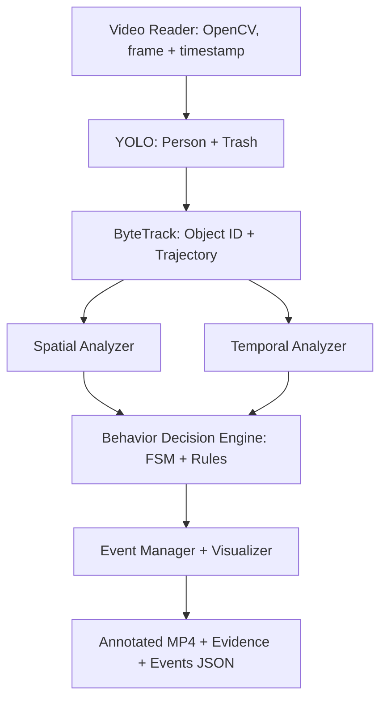
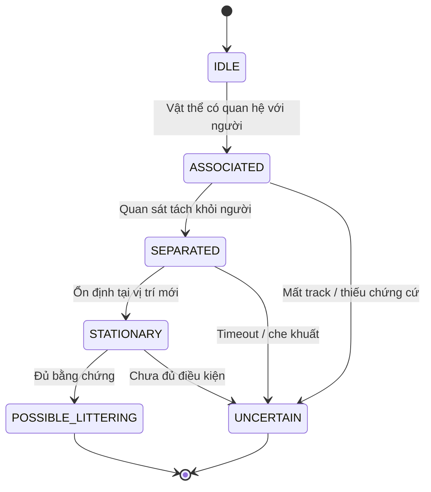

# PROJECT BUILD PLAN — AI Littering Behavior Detection

**Đề tài:** Phát hiện hành vi xả rác của con người trong video bằng Object Detection, ByteTrack và Spatio-Temporal Reasoning.

## 1. Mục tiêu và phạm vi dự án

Xây dựng hệ thống Computer Vision có khả năng xác định **hành vi nghi vấn xả rác** thông qua việc theo dõi hai loại đối tượng: **con người (Person)** và **rác (Trash)**, kết hợp phân tích tọa độ, chuyển động và quan hệ giữa các đối tượng theo thời gian.

### Mục tiêu cốt lõi

1. Phát hiện người và vật thể có khả năng là rác trong video.
2. Theo dõi từng đối tượng và duy trì ID giữa các frame.
3. Tính toán tọa độ, khoảng cách, vận tốc và quan hệ giữa người với rác.
4. Phát hiện quá trình vật thể được mang, tách khỏi người và bị bỏ lại.
5. Phân loại sự kiện thành `LITTERING`, `NO_LITTERING` hoặc `UNCERTAIN` (cảnh báo ban đầu có thể đặt tên `POSSIBLE_LITTERING`).
6. Xuất video có bounding box, tracking ID, thông tin cảnh báo và JSON lưu sự kiện.

### Nguyên tắc triển khai

- **Open Source First:** tận dụng model và thuật toán có sẵn, không huấn luyện AI từ đầu.
- **Minimal Working System First:** hoàn thiện pipeline hoạt động trước khi tối ưu độ chính xác hoặc hiệu suất.
- **Rule-based Behavior Recognition:** chưa sử dụng mô hình Action Recognition, VLM hay Pose Estimation.
- **Modular Architecture:** có thể thay model detection, tracker hoặc thuật toán hành vi độc lập.
- **Offline First:** ưu tiên xử lý video đầu vào, sau đó mới mở rộng sang camera thời gian thực.
- **Không xây dựng dataset lớn trong giai đoạn đầu:** chỉ dùng một vài video để xác minh khả năng vận hành.

### Phạm vi V1

| Hạng mục | Quyết định |
|---|---|
| Input | MP4 / video file |
| Detection | YOLO pretrained |
| Classes | Person + Trash |
| Tracking | ByteTrack |
| Spatial Analysis | OpenCV + NumPy |
| Temporal Analysis | Sliding Window / Track History |
| Behavior Recognition | Finite State Machine + Rules |
| Output | Annotated MP4 + Events JSON |
| Runtime | Python, một tiến trình |
| Training / Fine-tuning | Chưa thực hiện |
| Web UI / Database / Cloud | Ngoài phạm vi V1 |

**Định nghĩa hoàn thành V1:** hệ thống xử lý video từ đầu đến cuối, theo dõi người và vật thể, xác định một số sự kiện nghi vấn xả rác, cung cấp bằng chứng trực quan và không bị lỗi runtime. Đây là POC kỹ thuật, chưa phải hệ thống tự động kết luận vi phạm trong môi trường thực tế.

---

## 2. Kiến trúc hệ thống



- **Video Reader:** đọc frame, FPS và timestamp.
- **Object Detection:** trả bounding box, class và confidence.
- **Tracking:** gán ID cho object qua các frame.
- **Spatial Analyzer:** tính khoảng cách, vị trí tương đối, vận tốc.
- **Temporal Analyzer:** tính history, ổn định chuyển động và trình tự sự kiện.
- **Behavior Decision Engine:** phân tích chuyển trạng thái.
- **Event Manager + Visualizer:** chống cảnh báo trùng, xuất kết quả và bằng chứng.

Mỗi frame chỉ chạy detection/tracking một lần; các module phía sau xử lý metadata và history.

## 3. Technology Stack và Open Source

| Component | Technology | Cách triển khai |
|---|---|---|
| Detector | YOLO11m | Pretrained weights |
| Tracker | ByteTrack | Ultralytics built-in |
| Geometry | NumPy | Custom functions |
| Frame processing | OpenCV | Video I/O + coordinates |
| History | `collections.deque` | Sliding window |
| Behavior | Python | Finite State Machine |
| Visualization | OpenCV | Bounding boxes, overlays |
| Testing | pytest | Unit + integration |
| Configuration | YAML | Tập trung thresholds |

### Baseline ưu tiên

- Repo: [BaraaAlsaker/littering-detection](https://github.com/BaraaAlsaker/littering-detection).
- [Pretrained weights / Releases](https://github.com/BaraaAlsaker/littering-detection/releases).
- Tham khảo pipeline YOLO11m + ByteTrack + temporal rules; xây dựng lại cấu trúc source thành các module riêng.
- **Fallback:** nếu pretrained trash weights không hoạt động tốt, thử detector COCO với các class như `person`, `bottle`, `cup` và ánh xạ các vật thể phù hợp về nhóm rác ứng viên. YOLO COCO không có class `trash` tổng quát.
- ByteTrack: dùng `tracker="bytetrack.yaml"` và `persist=True` khi xử lý tuần tự frame theo tài liệu [Ultralytics tracking](https://docs.ultralytics.com/modes/track/).

**Lưu ý:** kiểm tra bản quyền/licensing của code và weights trước khi sử dụng, chia sẻ hoặc thương mại hóa.

---

## 4. Project Structure

```text
littering-detection/
│
├── main.py
├── config.yaml
├── requirements.txt
├── README.md
│
├── core/
│   ├── detector.py
│   ├── tracker.py
│   ├── geometry.py
│   ├── history.py
│   ├── association.py
│   ├── behavior.py
│   └── events.py
│
├── pipeline/
│   └── video_processor.py
│
├── utils/
│   └── visualizer.py
│
├── tests/
│   ├── test_geometry.py
│   ├── test_association.py
│   └── test_behavior.py
│
├── weights/
├── inputs/
└── outputs/
    ├── videos/
    ├── evidence/
    └── events/
```

| Module | Nhiệm vụ |
|---|---|
| `detector.py` | Load YOLO, chuẩn hóa class và bounding boxes |
| `tracker.py` | Tích hợp ByteTrack, trả track IDs |
| `geometry.py` | Tính tọa độ, khoảng cách, vận tốc |
| `history.py` | Lưu lịch sử từng object |
| `association.py` | Xác định quan hệ Person–Trash |
| `behavior.py` | Nhận diện chuyển trạng thái hành vi |
| `events.py` | Quản lý sự kiện, chống cảnh báo trùng |
| `video_processor.py` | Điều phối pipeline |
| `visualizer.py` | Vẽ boxes, trajectories và cảnh báo |

`detector.py` và `tracker.py` có thể là hai adapter logic trên cùng một lệnh `YOLO.track()`; tránh thực hiện hai lần inference cho mỗi frame.

---

## 5. Implementation Roadmap

### Phase 1 — Foundation & Detection (M1)

**Tasks**

- [ ] Khởi tạo project, Python environment, dependencies.
- [ ] Tích hợp pretrained YOLO weights.
- [ ] Chuẩn hóa detection về hai class `PERSON` và `TRASH`.
- [ ] Thiết lập Video Reader và đọc tuần tự các frame.
- [ ] Xuất video có bounding boxes, nhãn và confidence.

**Acceptance:** Video được đọc/ghi thành công, phát hiện người và rác bằng model thực, không dùng detection giả lập.

### Phase 2 — Tracking & Object History (M2)

**Tasks**

- [ ] Tích hợp ByteTrack.
- [ ] Gán ID riêng cho từng object.
- [ ] Lưu bbox, center, class, confidence và timestamp.
- [ ] Xây dựng `TrackHistory` bằng sliding window.
- [ ] Xử lý track tạm mất detection và reset state giữa các video.

**Acceptance:** Trích xuất được trajectory theo Track ID, không lỗi khi object biến mất/xuất hiện lại.

### Phase 3 — Spatial & Temporal Analysis (M3)

**Tasks**

- [ ] Tính khoảng cách giữa người và rác.
- [ ] Chuẩn hóa khoảng cách theo kích thước bounding box người.
- [ ] Xác định object đang di chuyển hay đứng yên.
- [ ] Xây dựng Person–Trash association theo history.
- [ ] Phân biệt rác có sẵn và rác mới xuất hiện.
- [ ] Duy trì liên kết qua nhiều frame, kể cả khi rác bị che khuất ngắn hạn.

**Acceptance:** Hệ thống có thể xác định quan hệ người–rác, hướng chuyển động và trạng thái bỏ lại.

### Phase 4 — Behavior Decision Engine (M4 · Core Research)

**Tasks**

- [ ] Thiết kế Finite State Machine (FSM).
- [ ] Phát hiện trạng thái có quan hệ Person–Trash.
- [ ] Phát hiện sự tách khỏi người.
- [ ] Xác nhận vật thể nằm yên ở vị trí mới.
- [ ] Kiểm tra độ đầy đủ của evidence.
- [ ] Tạo cảnh báo nghi vấn xả rác.
- [ ] Có nhánh `UNCERTAIN` khi thiếu bằng chứng.
- [ ] Chống nhiều cảnh báo cho cùng một sự kiện.

**Acceptance:** Phát hiện sự kiện theo chuỗi trạng thái, không dựa duy nhất vào khoảng cách người–rác.

### Phase 5 — Integration & Output (M5 · V1 Complete)

**Tasks**

- [ ] Hoàn thiện CLI chạy toàn pipeline.
- [ ] Overlay trajectory, IDs, trạng thái và cảnh báo.
- [ ] Lưu sự kiện dạng JSON.
- [ ] Lưu ảnh evidence.
- [ ] Log lỗi và thống kê xử lý.
- [ ] Unit tests cho geometry/association/behavior.
- [ ] README hướng dẫn cấu hình và chạy.

**Acceptance:** Chạy toàn hệ thống qua một lệnh, nhận annotated video và events JSON.

---

## 6. Thuật toán phát hiện hành vi

### 6.1. Object Tracking Data Contract

Mỗi đối tượng quan sát được:

```python
TrackedObject = {
    "track_id": 12,
    "class_name": "trash",
    "confidence": 0.91,
    "bbox": [x1, y1, x2, y2],
    "center": [cx, cy],
    "timestamp": 2.35,
}
```

Các frame mất detection phải đánh dấu `missing`/`predicted`, không coi là quan sát chắc chắn.

### 6.2. Spatial Analysis

**A. Khoảng cách tâm giữa người và rác:**

\[
d(P,T) = \sqrt{(x_P-x_T)^2 + (y_P-y_T)^2}
\]

**B. Chuẩn hóa theo chiều cao bounding box người:**

\[
d_{norm} = \frac{d(P,T)}{h_P}
\]

Khi xét vật thể gần người, nên kết hợp khoảng cách từ tâm rác đến điểm gần nhất trên bbox người (hoặc khoảng cách giữa các bbox), không chỉ khoảng cách center.

**C. Vận tốc tương đối của rác:**

\[
v_T = \frac{\left\|T_t-T_{t-k}\right\|}{t_t-t_{t-k}}
\]

Dùng tọa độ đã làm mượt và thời gian thực để giảm ảnh hưởng của FPS.

**D. Đứng yên:** vật thể có tổng độ dịch chuyển thấp dưới ngưỡng trong khoảng `min_stationary_seconds`. Đây chỉ là dấu hiệu vật thể ổn định trong khung hình, không phải bằng chứng 3D chắc chắn rằng nó nằm trên mặt đất.

### 6.3. Person–Trash Association

Không được mặc định người gần vật thể rác nhất là người xả rác. Quy tắc gợi ý:

- Vật thể xuất hiện liên tục gần thân/tay người.
- Người và vật thể có chuyển động tương quan trong một khoảng thời gian.
- Sau đó vật thể chuyển động độc lập hoặc bị bỏ lại.
- Duy trì `associated_person_id` trước đó ngay cả sau khi rác tách ra.
- Nếu rác xuất hiện gần một người nhưng thiếu lịch sử phù hợp, trả `UNCERTAIN`.

### 6.4. Finite State Machine



- `IDLE`: chưa có sự kiện.
- `ASSOCIATED`: vật thể có bằng chứng liên quan đến người.
- `SEPARATED`: vật thể tách khỏi người.
- `STATIONARY`: vật thể dừng tại vị trí mới.
- `POSSIBLE_LITTERING`: đủ điều kiện tạo cảnh báo nghi vấn.
- `UNCERTAIN`: mất track, thiếu evidence hoặc trường hợp mơ hồ.

FSM thực tế cần có timeout, recovery, abort và reset khi quan hệ không còn phù hợp. Với rác chỉ xuất hiện sau khi bị che khuất, có thể tạo nhánh `NEW_TRASH_CANDIDATE`, nhưng không tự động gán trách nhiệm cho người gần nhất.

### 6.5. Event Validation

| Điều kiện | Ý nghĩa |
|---|---|
| Association History | Có bằng chứng quan hệ người–rác |
| Separation | Có dấu hiệu tách khỏi người |
| Motion Change | Có chuyển động/biến đổi phù hợp |
| Stationary Duration | Ổn định tại vị trí mới |
| Pre-existing Filter | Không phải rác đã có từ trước |
| Track Confidence | Quan sát đủ liên tục, không chỉ một frame |
| Duplicate Suppression | Chưa ghi sự kiện tương đương |

Không buộc tất cả bằng chứng phải hoàn hảo ở mọi tình huống. Khi không đủ căn cứ, dùng `UNCERTAIN` thay vì kết luận chắc chắn.

---

## 7. Configuration

```yaml
model:
  path: weights/best.pt
  confidence: 0.25
  imgsz: 640
  device: auto

tracking:
  tracker: bytetrack.yaml

history:
  window_seconds: 2.0
  max_missing_seconds: 0.5

spatial:
  near_distance_ratio: 0.6
  separation_distance_ratio: 0.9
  stationary_motion_ratio: 0.05

behavior:
  min_association_seconds: 0.4
  min_stationary_seconds: 0.8
  event_cooldown_seconds: 2.0

output:
  save_video: true
  save_events: true
  save_evidence: true
  draw_trajectories: true
```

**Quan trọng:** tất cả thresholds ở trên chỉ là giá trị khởi tạo, **chưa được xác minh hoặc tối ưu**. Các `ratio` cần được định nghĩa rõ theo kích thước tham chiếu, và các threshold thời gian được tính bằng giây.

## 8. Pipeline Execution

Pseudo-code điều phối:

```python
def process_video(video_path):
    video = VideoReader(video_path)

    tracker.reset()
    history.reset()
    behavior.reset()

    for frame, timestamp in video:
        objects = tracker.track(frame)  # YOLO + ByteTrack cùng lần gọi

        history.update(objects, timestamp)
        relations = association.analyze(objects, history)
        raw_events = behavior.update(objects, relations, history, timestamp)
        events = event_manager.filter_duplicates(raw_events)

        output_frame = visualizer.draw(frame, objects, relations, events)
        video_writer.write(output_frame)
        event_manager.save(events)

    video.close()
    video_writer.close()
```

## 9. Output Specifications

```text
outputs/
├── videos/
│   └── sample_annotated.mp4
├── evidence/
│   └── event_001.jpg
└── events/
    └── sample_events.json
```

Ví dụ event:

```json
{
  "event_id": "event_001",
  "event_type": "POSSIBLE_LITTERING",
  "timestamp": 4.23,
  "person_id": 3,
  "trash_id": 12,
  "evidence": ["associated", "separated", "stationary"],
  "evidence_image": "event_001.jpg"
}
```

Các giá trị chỉ mang tính minh họa. Nếu không xác định được người liên quan, `person_id` phải là `null`, không đoán ID. Video có màu/nhãn phân biệt người, rác và object ứng viên sự kiện.

---

## 10. Verification & Acceptance Criteria

Chỉ cần một số clip ngắn để kiểm tra pipeline, **không xây dựng dataset lớn trong V1**.

| Test | Mục tiêu |
|---|---|
| T1 — Detection | YOLO phát hiện người và vật thể |
| T2 — Tracking | ByteTrack duy trì ID trên frame liên tiếp |
| T3 — Association | Có bằng chứng quan hệ người–rác |
| T4 — Separation | Phát hiện vật thể tách khỏi người |
| T5 — Stationary | Phát hiện vật thể ổn định tại vị trí mới |
| T6 — Negative Case | Người đi ngang rác có sẵn không bị báo xả rác |
| T7 — Event Generation | Một sự kiện tạo tối đa một cảnh báo |
| T8 — Output | Video và JSON ghi đầy đủ |

Khi có đủ dữ liệu đánh giá, bổ sung **Event Precision, Recall và False Alarms per Video/Hour**. Không lấy detection mAP của YOLO làm chất lượng của toàn bộ hệ thống.

### Rủi ro chính

| Rủi ro | Xử lý V1 |
|---|---|
| YOLO không nhận được rác nhỏ | Thu hẹp loại rác hoặc đổi pretrained weights |
| Trash ID bị mất | Short-term history, nối lại theo vị trí/thời gian |
| Rác cũ bị nhận là rác mới | Initial scene calibration |
| Nhiều người đứng gần rác | Lịch sử association thay vì chỉ proximity |
| Người nhặt vật lên | Không kích hoạt nếu không có chuỗi bỏ lại |
| Người bỏ đồ vào thùng rác | Không kết luận chắc chắn khi chưa nhận diện thùng/ROI hợp lệ |
| Camera chuyển động | V1 chỉ hỗ trợ camera cố định |

## 11. Ngoài phạm vi V1

- Custom training hoặc fine-tuning.
- Xây dựng/gán nhãn dataset lớn.
- Pose Estimation, Action Recognition, VLM.
- Web app, API, database.
- Multi-camera tracking.
- Định vị 3D / camera calibration phức tạp.
- TensorRT, ONNX hoặc tối ưu GPU nâng cao.
- Tự động xử phạt hay xác định danh tính người.

Chỉ bổ sung khi V1 chứng minh có vấn đề cụ thể cần giải quyết.

## 12. Definition of Done — V1 Build Checklist

- [ ] Chạy project qua một lệnh CLI với đường dẫn video đầu vào.
- [ ] YOLO + ByteTrack hoạt động xuyên suốt video.
- [ ] Có track history, spatial metrics và temporal metrics.
- [ ] Behavior Engine phát hiện chuỗi hành vi, không chỉ dựa vào proximity.
- [ ] Có bộ lọc rác tồn tại sẵn và cảnh báo trùng.
- [ ] Có trạng thái `UNCERTAIN` khi thiếu bằng chứng.
- [ ] Xuất MP4 annotate, ảnh evidence và `events.json`.
- [ ] Các module chính có unit tests và project có README hướng dẫn.

## 13. Quyết định cuối cùng

**Build project Python riêng, không fork toàn bộ CivicSense.** Tận dụng weights và ý tưởng từ `littering-detection`, sử dụng ByteTrack trực tiếp từ Ultralytics. Trình tự ưu tiên:

> **Detection → Tracking → Object History → Spatial/Temporal Analysis → Behavior Engine → Event Output**

Hoàn thành từng milestone trước khi chuyển sang giai đoạn tiếp theo. Nếu thành phần hiện tại đạt yêu cầu tối thiểu, không cần tìm model, tracker hay thuật toán mới.

**Kết quả mong muốn:** pipeline phát hiện **sự kiện nghi vấn xả rác có thể giải thích được**, vận hành ổn định, dễ mở rộng và có nền tảng để phát triển thành đề tài Computer Vision hoàn chỉnh.

### Tài liệu tham khảo

- [BaraaAlsaker/littering-detection](https://github.com/BaraaAlsaker/littering-detection)
- [BaraaAlsaker/littering-detection — Releases](https://github.com/BaraaAlsaker/littering-detection/releases)
- [Ultralytics — Multi-object Tracking](https://docs.ultralytics.com/modes/track/)
- [CivicSense](https://github.com/muhammad-fiaz/civicsense)
- [MIVIA — Illegal Waste Dumping](https://github.com/MiviaLab/IllegalWasteDumping)
