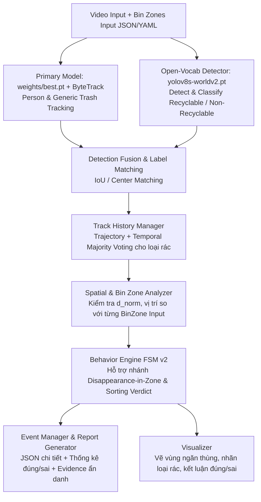
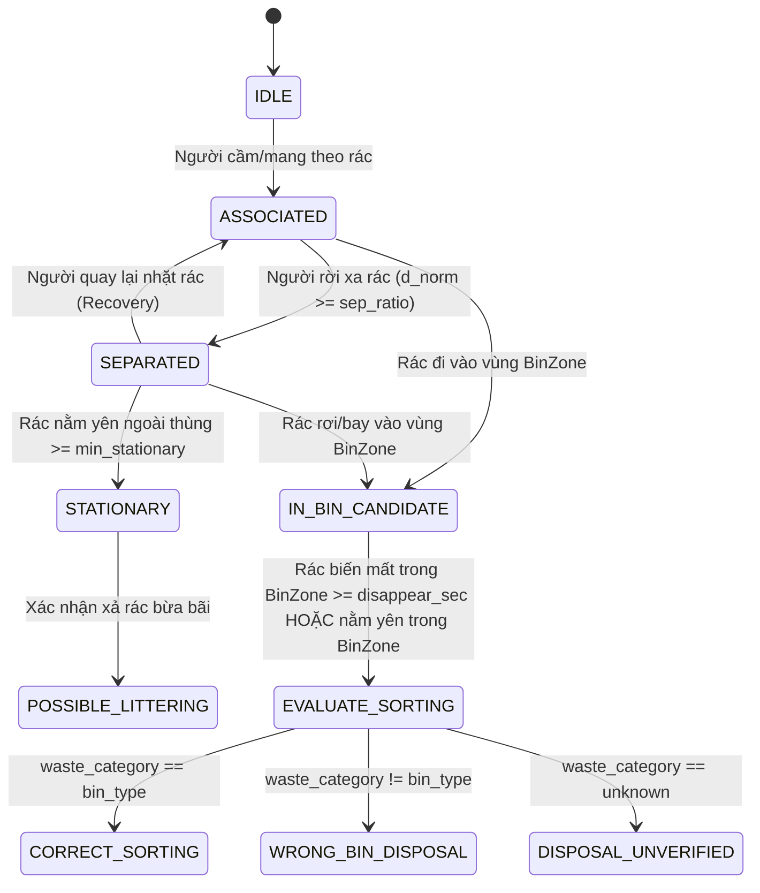

# KẾ HOẠCH TRIỂN KHAI TÍNH NĂNG PHÁT HIỆN, PHÂN LOẠI RÁC (TÁI CHẾ / KHÔNG TÁI CHẾ) VÀ ĐÁNH GIÁ VỨT ĐÚNG NƠI QUY ĐỊNH

**Dự án:** AI Littering Behavior Detection System (KHKT THCS)  
**Phạm vi nâng cấp:** Bổ sung năng lực Object Detection phân loại rác (`recyclable` / `non_recyclable`) bằng `yolov8s-worldv2.pt`, cấu hình vị trí ngăn thùng rác từ đầu vào người dùng (Manual Bin Zone Input) và suy luận đánh giá hành vi vứt rác đúng hay sai nơi quy định.

---

## 1. Mục tiêu & Bài toán thực tế

### 1.1. Mục tiêu kỹ thuật
1. **Detection + Classification đồng thời:** Không chỉ phân loại ảnh tĩnh mà phát hiện trực tiếp vị trí (bounding box) và phân loại từng vật thể rác thành 2 nhóm theo đúng quy chuẩn thùng rác trường học:
   - `recyclable` (**Rác tái chế**): giấy, chai nhựa, lon kim loại, hộp giấy/carton.
   - `non_recyclable` (**Rác không tái chế**): túi nilon, vỏ bánh kẹo, hộp xốp, khăn giấy, ly/ống hút dùng một lần, rác thực phẩm.
2. **Thiết lập vị trí ngăn thùng rác từ Input (Không tự động detect thùng rác):**
   - Tắt model tự động phát hiện thùng rác để tiết kiệm tài nguyên tính toán và loại bỏ hoàn toàn sai số nhận diện nhầm ngăn thùng.
   - Cho phép người dùng khai báo trực tiếp tọa độ từng ngăn thùng (`recyclable` và `non_recyclable`) qua file cấu hình YAML/JSON hoặc công cụ vẽ vùng tương tác.
3. **Đánh giá & Báo cáo "Đã vứt đúng chỗ chưa":**
   - Kết hợp lịch sử theo dõi người – rác với vùng ngăn thùng rác để kết luận 4 kịch bản rõ ràng:
     - `CORRECT_SORTING`: Bỏ rác vào **đúng ngăn** theo loại rác.
     - `WRONG_BIN_DISPOSAL`: Bỏ rác vào thùng nhưng **sai ngăn** (ví dụ: chai nhựa bỏ vào ngăn không tái chế).
     - `POSSIBLE_LITTERING`: Vứt rác **ngoài thùng** (trên sàn hoặc cạnh thùng).
     - `DISPOSAL_UNVERIFIED`: Đã bỏ vào thùng nhưng độ tin cậy phân loại rác chưa đủ ngưỡng để kết luận đúng/sai ngăn.

### 1.2. Bài toán đặc thù cần giải quyết (Từ thực tế thùng rác trường học)
Quan sát thực tế thùng rác đôi tại trường (`inputs/IMG_6819.HEIC`: ngăn trái màu xanh lá — *Rác tái chế*, ngăn phải màu vàng — *Rác không tái chế*):
- Thùng rác là **thùng kín có lỗ bỏ rác**. Khi học sinh bỏ rác vào thùng, vật thể rác sẽ **biến mất ngay tại vùng miệng ngăn thùng** chứ không nằm yên lộ thiên trong khung hình.
- Do đó, thuật toán FSM hiện tại (chỉ kiểm tra rác nằm yên `is_stationary`) sẽ bỏ sót phần lớn hành vi bỏ vào thùng. Kế hoạch này bổ sung cơ chế **phát hiện bỏ rác qua sự kiện biến mất trong vùng ngăn thùng (Disappearance-in-Zone)**.

---

## 2. Kiến trúc tổng thể sau nâng cấp



### Điểm tối ưu so với kiến trúc cũ
- **Không chạy `yolov8s-worldv2.pt` để tìm thùng rác nữa:** Chuyển toàn bộ sức mạnh của `yolov8s-worldv2.pt` sang **phát hiện và phân loại vật thể rác** theo từ vựng mở.
- **Tối ưu tốc độ (FPS):** Có thể cấu hình tham số `classify_every_n_frames` (mặc định `1` hoặc `2` frame/lần) kết hợp lưu phiếu bầu theo `track_id` trong `TrackHistory`, giúp giữ tốc độ ổn định trên MPS/CUDA/CPU.

---

## 3. Thiết kế chi tiết từng thành phần

### 3.1. Cơ chế Input vị trí thùng rác (Manual Bin Zone Setup)

#### A. Cấu trúc dữ liệu `BinZone` (Module mới: `core/bin_zones.py`)
Mỗi ngăn thùng rác được mô tả bởi một đối tượng `BinZone`:
- `bin_id` (`str` hoặc `int`): Mã định danh ngăn thùng (ví dụ: `"BIN_RECYCLABLE_1"`, `"BIN_NON_RECYCLABLE_1"`).
- `bin_type` (`str`): `"recyclable"` hoặc `"non_recyclable"`.
- `label` (`str`): Tên hiển thị (ví dụ: `"Rac Tai Che"`, `"Rac Khong Tai Che"`).
- `shape` (`str`): `"bbox"` (`[x1, y1, x2, y2]`) hoặc `"polygon"` (`[[x1, y1], [x2, y2], ...]`).
- `normalized` (`bool`): `true` nếu tọa độ nằm trong `[0.0, 1.0]` (tự động nhân với `width, height` của video để không phụ thuộc độ phân giải), `false` nếu là tọa độ pixel tuyệt đối.
- `drop_zone_bbox` / `drop_zone_polygon` *(tùy chọn)*: Vùng miệng lỗ bỏ rác (nếu không khai báo, hệ thống mặc định lấy toàn bộ vùng ngăn thùng hoặc nửa trên của ngăn thùng).

#### B. 3 cách cung cấp Input cho người dùng
1. **Khai báo trực tiếp trong `config.yaml`:** Phù hợp cho camera cố định một góc quay.
2. **Truyền file cấu hình riêng qua CLI:** `python main.py -i inputs/IMG_6815.MOV --bins-config inputs/bins_cam1.json` (rất tiện khi bộ dữ liệu có nhiều góc quay khác nhau).
3. **Công cụ vẽ vùng tương tác (`tools/setup_bin_zones.py`):**
   - Chạy `python tools/setup_bin_zones.py -i inputs/IMG_6815.MOV -o inputs/bins_IMG_6815.json`.
   - Hiển thị frame đầu tiên của video; người dùng kéo chuột (hoặc chấm 4 điểm đa giác) chọn vùng **Ngăn tái chế** (nhấn `1`) và vùng **Ngăn không tái chế** (nhấn `2`), nhấn `s` để lưu ra file JSON chuẩn hóa `[0.0..1.0]`.

#### C. Mẫu cấu hình trong `config.yaml`
```yaml
bin_zones:
  mode: "manual"               # 'manual' (lấy từ input), tắt hoàn toàn auto bin detection
  config_file: null            # Đường dẫn file JSON riêng (nếu truyền từ CLI sẽ ghi đè)
  near_bin_margin_ratio: 0.35  # Mở rộng biên vùng thùng theo tỷ lệ chiều rộng thùng để nhận diện "cạnh thùng"
  zones:
    - bin_id: "BIN_REC_1"
      bin_type: "recyclable"
      label: "Rac Tai Che"
      shape: "bbox"
      normalized: true
      coords: [0.28, 0.42, 0.47, 0.92]
    - bin_id: "BIN_NONREC_1"
      bin_type: "non_recyclable"
      label: "Rac Khong Tai Che"
      shape: "bbox"
      normalized: true
      coords: [0.47, 0.42, 0.66, 0.92]
```

---

### 3.2. Detection & Classification rác bằng `yolov8s-worldv2.pt` (`core/detector.py` & `core/tracker.py`)

#### A. Từ điển Prompt phân loại rác (Configurable trong `config.yaml`)
```yaml
waste_classification:
  enabled: true
  model_path: "yolov8s-worldv2.pt"
  confidence: 0.18
  imgsz: 640
  classify_every_n_frames: 1
  min_vote_confidence: 0.25    # Ngưỡng điểm bầu tối thiểu để chốt nhãn loại rác
  recyclable_prompts:
    - "plastic bottle"
    - "water bottle"
    - "aluminum can"
    - "soda can"
    - "metal can"
    - "paper"
    - "crumpled paper"
    - "cardboard"
    - "milk carton"
  non_recyclable_prompts:
    - "plastic bag"
    - "snack bag"
    - "food wrapper"
    - "styrofoam container"
    - "foam box"
    - "tissue paper"
    - "napkin"
    - "disposable cup"
    - "plastic straw"
    - "food waste"
```

#### B. Hợp nhất kết quả Detection (Detection Fusion)
Tại mỗi frame, hệ thống kết hợp 2 nguồn phát hiện:
1. **`weights/best.pt` + ByteTrack:** Đảm bảo theo dõi `person` và các vật thể `trash` nhỏ ổn định qua các frame.
2. **`yolov8s-worldv2.pt`:** Chạy detection với toàn bộ danh sách `recyclable_prompts + non_recyclable_prompts` (đã `set_classes` 1 lần khi khởi tạo).
3. **Quy tắc ghép nhãn (Fusion Rules):**
   - Với mỗi `trash` track từ `best.pt`, tìm detection của YOLO-World có `IoU >= 0.25` (hoặc tâm nằm trong bbox của nhau) và độ tin cậy cao nhất $\rightarrow$ gán `waste_category` (`recyclable` / `non_recyclable`), `waste_raw_label` (ví dụ `"plastic bottle"`) và `waste_confidence`.
   - Nếu YOLO-World phát hiện một vật thể rác rõ ràng (`conf >= 0.30`) nằm gần người hoặc trong vùng quan tâm mà `best.pt` bỏ sót, tạo thêm candidate `TrackedObject` (hoặc đồng bộ tracker) để không mất sự kiện.

#### C. Mở rộng `TrackedObject` và `TrackHistory` (`core/tracker.py`, `core/history.py`)
- Thêm trường vào `TrackedObject`:
  - `waste_category: str = "unknown"` (`"recyclable"`, `"non_recyclable"`, `"unknown"`)
  - `waste_raw_label: str = ""`
  - `waste_confidence: float = 0.0`
- Thêm **Temporal Majority Voting** vào `TrackHistory`:
  - Lưu cộng dồn điểm tin cậy theo từng nhóm: `category_scores = {"recyclable": float, "non_recyclable": float}`.
  - Phương thức `get_resolved_waste_category(min_score)` trả về nhãn ổn định nhất cùng độ tin cậy tổng hợp, tránh hiện tượng nhãn nhảy qua lại giữa các frame khi vật thể đang di chuyển hoặc bị nghiêng góc.

---

### 3.3. Phân tích không gian với `BinZone` (`core/association.py`)

Thay thế logic tìm thùng rác động bằng truy vấn trực tiếp danh sách `BinZone` từ Input:
- Hàm `point_in_bin_zone(center, bbox, bin_zone)` (trong `core/geometry.py`):
  - Hỗ trợ cả `bbox` (kiểm tra tâm nằm trong hoặc `IoU >= bin_iou_threshold`) và `polygon` (dùng `cv2.pointPolygonTest`).
- Bổ sung vào `PersonTrashRelation`:
  - `target_bin_id: Optional[str]`
  - `target_bin_type: Optional[str]` (`"recyclable"` / `"non_recyclable"`)
  - `is_inside_bin: bool`
  - `is_near_bin: bool` (chuẩn hóa theo kích thước `BinZone` thay vì cố định `150px`)
  - `waste_category: str` (lấy từ kết quả Majority Voting của `TrackHistory`)
  - `waste_raw_label: str`

---

### 3.4. Máy trạng thái FSM v2 & Đánh giá "Vứt đúng chỗ chưa" (`core/behavior.py`)

#### A. Bổ sung trạng thái mới vào `BehaviorState`
- `CORRECT_SORTING`: Bỏ rác vào thùng và **đúng ngăn phân loại**.
- `WRONG_BIN_DISPOSAL`: Bỏ rác vào thùng nhưng **sai ngăn phân loại**.
- `DISPOSAL_UNVERIFIED`: Bỏ rác vào thùng nhưng loại rác đang là `unknown`.
- `POSSIBLE_LITTERING`: Vứt rác ra ngoài thùng (sàn hoặc cạnh thùng).
- `UNCERTAIN`: Không đủ căn cứ kết luận.

#### B. Sơ đồ chuyển trạng thái FSM v2



#### C. Xử lý sự kiện "Biến mất trong vùng thùng" (Disappearance-in-Zone)
Trong `BehaviorEngine.update()`, ngoài các vật thể đang xuất hiện ở frame hiện tại, duyệt thêm các `trash_id` đang ở trạng thái `ASSOCIATED` / `SEPARATED` / `IN_BIN_CANDIDATE` nhưng vừa **không còn xuất hiện** trong frame hiện tại:
1. Kiểm tra vị trí quan sát cuối cùng (`last_obs`) của vật thể rác: có nằm trong `BinZone` (hoặc cách miệng `BinZone` dưới ngưỡng nhỏ theo vector chuyển động hướng về miệng thùng) hay không.
2. Nếu đã biến mất liên tục $\ge$ `disappear_confirm_seconds` (mặc định `0.4s`), đồng thời lịch sử chứng minh rác từng `ASSOCIATED` với `person_id`:
   - Chốt loại rác cuối cùng từ `TrackHistory.get_resolved_waste_category()`.
   - Đối chiếu với `target_bin.bin_type` để sinh sự kiện `CORRECT_SORTING`, `WRONG_BIN_DISPOSAL`, hoặc `DISPOSAL_UNVERIFIED`.
3. Đồng thời bổ sung **nhánh Recovery**: nếu ở trạng thái `SEPARATED` mà `d_norm` quay lại `<= near_distance_ratio` và rác di chuyển theo người trở lại, đưa FSM về `ASSOCIATED` để tránh báo oan khi học sinh chỉ đặt tạm rồi cầm lại.

---

### 3.5. Báo cáo kết quả, Ảnh bằng chứng & Trực quan hóa (`core/events.py`, `utils/visualizer.py`)

#### A. Định dạng JSON báo cáo mới (`outputs/events/<video>_events.json`)
```json
{
  "summary": {
    "total_events": 3,
    "correct_sorting_count": 1,
    "wrong_bin_disposal_count": 1,
    "possible_littering_count": 1,
    "disposal_unverified_count": 0,
    "sorting_accuracy_percent": 50.0
  },
  "events": [
    {
      "event_id": "EVT_0001",
      "event_type": "WRONG_BIN_DISPOSAL",
      "is_correct_place": false,
      "timestamp": 5.42,
      "person_id": 1,
      "trash_id": 14,
      "waste_category": "recyclable",
      "waste_raw_label": "plastic bottle",
      "waste_category_confidence": 0.78,
      "target_bin_id": "BIN_NONREC_1",
      "target_bin_type": "non_recyclable",
      "evidence": ["associated", "entered_bin_zone", "disappeared_in_bin", "wrong_bin"],
      "status_message": "Vứt sai ngăn: Người #1 bỏ Rác tái chế (plastic bottle) vào ngăn Rác không tái chế (BIN_NONREC_1)",
      "evidence_image": "sample_EVT_0001.jpg"
    }
  ]
}
```
*Lưu ý:* Với sự kiện `disappeared_in_bin`, hệ thống lưu lại **snapshot frame trước khi rác biến mất** (lúc vật thể nằm ngay miệng thùng và vẫn nhìn rõ vật thể + người) để xuất ảnh bằng chứng thuyết phục nhất (vẫn tự động làm mờ vùng mặt học sinh).

#### B. Trực quan hóa trên Video (`utils/visualizer.py`)
- **Vẽ cố định các `BinZone` từ Input:**
  - Ngăn `recyclable`: khung viền màu **xanh lá** + nền bán trong suốt + nhãn `[TAI CHE]`.
  - Ngăn `non_recyclable`: khung viền màu **vàng** + nền bán trong suốt + nhãn `[KHONG TAI CHE]`.
- **Nhãn vật thể rác:** Hiển thị rõ loại rác + trạng thái FSM, ví dụ `Rac #14 [TAI CHE: plastic bottle | ASSOCIATED]`.
- **Banner kết luận cuối sự kiện:**
  - Màu xanh lục: `DUNG CHO: Nguoi #1 bo Rac tai che vao ngan Tai che`.
  - Màu cam đậm: `SAI NGAN: Nguoi #1 bo Rac tai che vao ngan Khong tai che`.
  - Màu đỏ: `XA RAC BUA BAI: Nguoi #1 bo lai Rac tai che ngoai thung`.
- **HUD góc trên trái:** Hiển thị thêm bộ đếm live: `Dung cho: X | Sai ngan: Y | Xa bua bai: Z`.

---

## 4. Lộ trình triển khai theo từng giai đoạn (Implementation Roadmap)

| Giai đoạn | Phạm vi công việc & Tệp tác động | Tiêu chí nghiệm thu (Acceptance Criteria) |
| :--- | :--- | :--- |
| **Phase 1: Input Bin Zones** | Tạo `core/bin_zones.py`, cập nhật `config.yaml`, `main.py` (`--bins-config`), tạo công cụ tương tác `tools/setup_bin_zones.py`. | Đọc đúng `bbox`/`polygon` (chuẩn hóa và pixel), vẽ chính xác 2 ngăn lên frame video, tắt hoàn toàn auto-detect thùng rác. |
| **Phase 2: Waste Detection & Voting** | Cập nhật `core/detector.py`, `core/tracker.py`, `core/history.py`. Tích hợp `yolov8s-worldv2.pt` với prompt 2 nhóm rác, ghép IoU với track từ `best.pt`, thêm Majority Voting theo thời gian. | Phát hiện được bounding box và phân loại đúng các vật mẫu phổ biến (chai nhựa, lon, giấy vs túi nilon, hộp xốp, vỏ bánh) với nhãn ổn định theo track ID. |
| **Phase 3: Spatial & FSM v2** | Cập nhật `core/geometry.py`, `core/association.py`, `core/behavior.py`. Thêm kiểm tra `point_in_bin_zone`, cơ chế `Disappearance-in-Zone`, nhánh Recovery khi nhặt lại rác và logic đánh giá đúng/sai ngăn. | Phân biệt rõ 4 kết quả: `CORRECT_SORTING`, `WRONG_BIN_DISPOSAL`, `DISPOSAL_UNVERIFIED`, `POSSIBLE_LITTERING`; không báo sai khi người đi ngang rác cũ. |
| **Phase 4: Reporting & Visualization** | Cập nhật `core/events.py`, `utils/visualizer.py`, `pipeline/video_processor.py`. Lưu snapshot trước lúc biến mất, xuất JSON kèm khối `summary`, vẽ vùng thùng và banner màu phân biệt. | Xuất đầy đủ video annotate, ảnh bằng chứng làm mờ mặt và JSON có trường `is_correct_place` + bảng thống kê cuối video. |
| **Phase 5: Testing & Benchmark** | Tạo `tests/test_waste_sorting.py`, cập nhật `tests/test_trash_bin.py`, `tests/test_behavior.py`, `tests/test_e2e_pipeline.py`. Chạy thử nghiệm thực tế trên lô video `inputs/IMG_6815.MOV`–`IMG_6830.MOV` và tinh chỉnh ngưỡng prompt/confidence. | 100% unit/E2E test pass (`pytest -v tests/`); có bảng kết quả thử nghiệm thực tế trên video quay tại trường. |

---

## 5. Rủi ro kỹ thuật & Phương án xử lý

| Rủi ro | Nguyên nhân | Phương án xử lý trong kế hoạch |
| :--- | :--- | :--- |
| YOLO-World nhầm lẫn giữa ly nhựa tái chế và ly dùng một lần, hoặc giấy bị vò nát | Vật thể nhỏ, bị che khuất bởi tay người cầm, ánh sáng sân trường thay đổi | Dùng **Temporal Majority Voting** qua nhiều frame trước khi rác vào thùng + tinh chỉnh bộ prompt và ngưỡng `min_vote_confidence`; nếu chưa chắc chắn trả về `DISPOSAL_UNVERIFIED` thay vì đoán bừa. |
| Mất dấu vật thể rác trước khi kịp chạm vào vùng `BinZone` | Tay người che khuất rác khi đưa lại gần miệng thùng | Kết hợp vùng `drop_zone` mở rộng nhẹ phía trước miệng thùng và kiểm tra vector chuyển động cuối cùng của rác + vị trí tay/thân người đang đứng sát ngăn thùng nào. |
| Góc quay thay đổi giữa các video test (`.MOV`) | Điện thoại cầm tay hoặc đặt ở nhiều vị trí khác nhau | Dùng `tools/setup_bin_zones.py` để tạo nhanh file JSON vùng thùng riêng cho từng video/góc quay trong 10 giây và truyền qua `--bins-config`. |
| Giảm FPS khi chạy cả `best.pt` và `yolov8s-worldv2.pt` | Hai lần inference trên mỗi frame | Cho phép cấu hình `classify_every_n_frames: 2` (chạy YOLO-World cách frame) và chỉ chạy phân loại khi trong frame có người hoặc có rác đang được theo dõi. |

---

## 6. Checklist hoàn thành (Definition of Done)

- [ ] `core/bin_zones.py` và `tools/setup_bin_zones.py` hoạt động, hỗ trợ cả `config.yaml` và `--bins-config`.
- [ ] `yolov8s-worldv2.pt` phát hiện và phân loại được `recyclable` / `non_recyclable` (Detection + Classification).
- [ ] `TrackHistory` tích lũy nhãn bằng Temporal Majority Voting.
- [ ] `BehaviorEngine` xử lý được cả rác rơi ngoài thùng lẫn rác biến mất vào trong ngăn thùng kín, trả về kết luận `CORRECT_SORTING` / `WRONG_BIN_DISPOSAL` / `POSSIBLE_LITTERING` / `DISPOSAL_UNVERIFIED`.
- [ ] `EventManager` xuất JSON kèm `summary` tỷ lệ vứt đúng chỗ và lưu ảnh bằng chứng có làm mờ khuôn mặt.
- [ ] `Visualizer` hiển thị trực quan 2 vùng ngăn thùng, loại rác và kết quả đánh giá đúng/sai chỗ.
- [ ] Toàn bộ bộ kiểm thử `pytest -v tests/` vượt qua và chạy thành công trên ít nhất 3 video thực tế trong `inputs/`.
